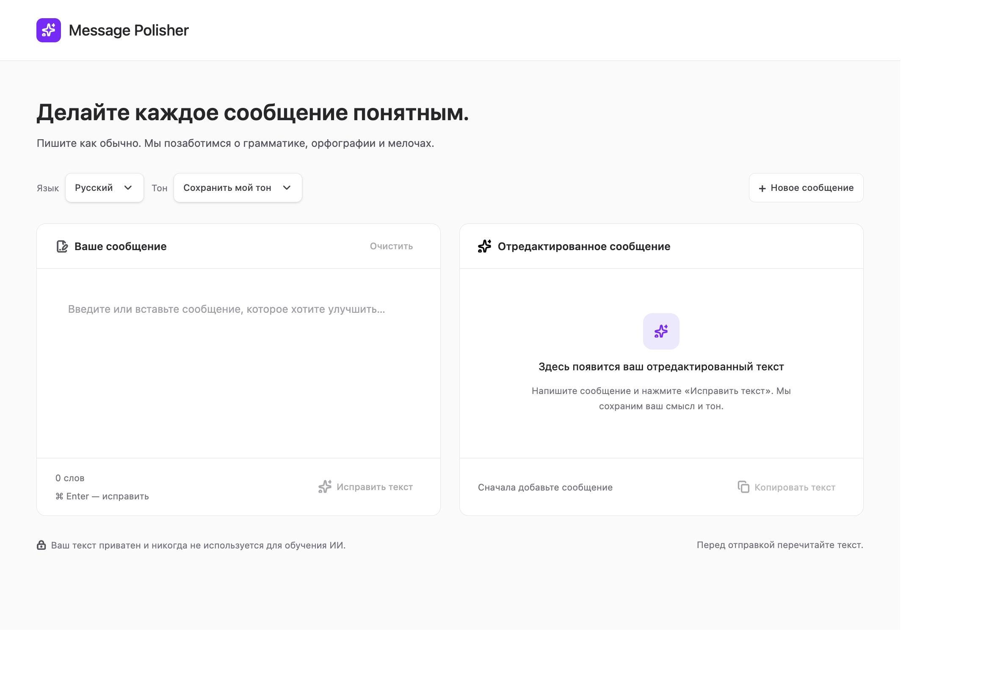

<div align="center">
  

  <h1>Message Polisher</h1>
  <p><strong>Делайте каждое сообщение понятным.</strong></p>
  <p>Улучшайте грамматику, орфографию и тон, сохраняя смысл сообщения.</p>

  <p>
    
    
    
    
  </p>
</div>

## Возможности

Message Polisher — небольшое веб-приложение для улучшения текстовых сообщений. Выберите язык и тон, вставьте черновик и получите отредактированный вариант с объяснением изменений.

- **Языки:** русский и английский
- **Тон:** сохранить исходный, нейтральный, дружелюбный, формальный или грубый
- **Объяснение изменений:** посмотрите, что и почему было исправлено
- **Копирование результата:** скопируйте готовый текст одним нажатием
- **Общие контракты:** типы запросов и ответов TypeScript используются и веб-приложением, и API

## Запуск с Docker Compose

### Требования

- Docker Desktop или Docker Engine с плагином Compose
- Ключ авторизации API GigaChat

Создайте файл `apps/api/.env` и добавьте в него ключ:

```env
GIGACHAT_AUTH_KEY=ваш-ключ-авторизации-gigachat
```

Затем из корневой папки репозитория соберите и запустите веб-приложение и API:

```bash
docker compose up --build
```

Откройте [http://localhost:4200](http://localhost:4200). API также доступен по адресу [http://localhost:3000](http://localhost:3000).

Чтобы остановить сервисы, выполните:

```bash
docker compose down
```

Контейнер API использует сертификат российского центра сертификации из `apps/api/certificates`. Проверка TLS-сертификатов остаётся включённой. Не публикуйте файл `apps/api/.env`: он исключён из Git.

## Локальная разработка

Установите зависимости из корневой папки репозитория:

```bash
npm ci
```

Создайте `apps/api/.env`, как описано выше. В отдельных окнах терминала запустите API и веб-приложение:

```bash
npm run start:api
```

```bash
npm run start:web
```

Локальный прокси Angular перенаправляет запросы `/api` на `http://localhost:3000`.

## Сборка и тесты

```bash
npm run build:web
npm run test:web
npm run build --workspace @ai-message-polisher/api
```

## Структура проекта

```text
apps/
  api/        API на Express и интеграция с GigaChat
  web/        Приложение Angular
packages/
  contracts/  Общие типы запросов и ответов TypeScript
```

Браузер отправляет запросы на обработку текста методом `POST /api/polish`. API проверяет запрос, обращается к GigaChat и возвращает отредактированный текст со списком изменений.

## Конфиденциальность

Отправленный на обработку текст передаётся API приложения, а затем GigaChat для подготовки результата. Не отправляйте конфиденциальную информацию, не ознакомившись с правилами использования соответствующих сервисов.

## Лицензия

См. файл [LICENSE](./LICENSE).
